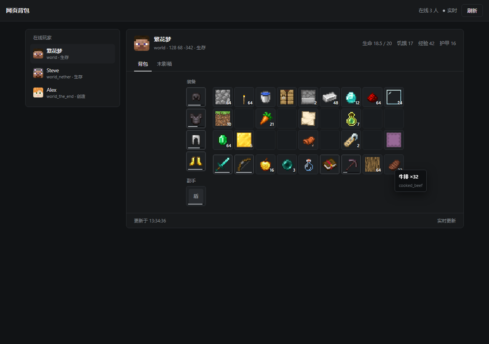

# WebBag

用浏览器查看服务器玩家的背包和末影箱，在线离线都能看。只读，不能改任何物品。

支持 Purpur / Paper 26.3。

在线玩家每秒刷新，进出服、换装备、丢东西都会跟着变。离线玩家直接读存档文件，看到的是上次保存的状态。名字和头像取自玩家皮肤。



## 安装

把 `WebBag-1.5.1.jar` 放进 `plugins/`，重启。游戏里执行 `/webbag link`，聊天栏会给一条带口令的网址，浏览器打开就能用。左侧是玩家列表，点谁看谁。

口令第一次访问后会存进 Cookie，30 天内不用再带。口令自动生成在 `plugins/WebBag/config.yml`。

## 离线玩家

列表左上角可以切「在线 / 离线」。离线页会扫 `world/players`、`world/players/data`、`world/playerdata` 里的存档，按最后保存时间倒序排列，点开看当时的背包、装备和末影箱。名字取自 `usercache.json`。

离线数据是静态的，点「刷新」重新读一次。没有存档文件的玩家不会出现在列表里。

## 命令

- `/webbag`：当前网址和在线人数
- `/webbag link`：带口令的完整网址
- `/webbag key` / `newkey`：查看或更换口令，换完旧链接失效
- `/webbag status`：端口、监听地址、在线人数
- `/webbag reload`：重载配置
- `/webbag selftest`：输出一份样例背包 JSON 和图标覆盖率

别名 `/wbag`、`/wbg`，权限 `webbag.admin`，默认只有 OP。

## 配置

`plugins/WebBag/config.yml`：

- `port`：默认 5001
- `bind`：默认 0.0.0.0，只走反代时改 127.0.0.1
- `public-url`：对外网址，留空则用本机内网 IP
- `access-key`：访问口令，留空时首次启动自动生成
- `live-update` / `live-interval-ms`：实时推送开关和间隔
- `refresh-seconds`：实时推送不可用时的备用轮询间隔，0 关闭
- `allow-ender-chest`：是否允许看末影箱
- `assets-cdn` / `assets-version`：语言文件来源，版本要和服务端对上

改完 `/webbag reload`，改端口要重启。

## 接口

除了 `/health` 和 `/api/lang`，都要带 `key` 参数或 Cookie。

- `/api/players`：在线玩家
- `/api/players?offline=1`：离线玩家
- `/api/inventory?player=<uuid>&type=inv|ender`：背包或末影箱
- `/api/skin?player=<uuid>`：皮肤头像
- `/api/tex?id=<物品名>`：物品图标
- `/api/diag`：图标覆盖率自检
- `/api/stream?player=<uuid>&type=inv|ender`：SSE 实时流

槽位和原版一致：0 到 8 快捷栏，9 到 35 主背包，36 到 39 装备，40 副手。地址后面加 `&scope=offline` 打开离线页，加 `&player=` 直接打开某个人的背包。

## 图标

图标在生成背包 JSON 时就以内联 base64 一起返回，页面不用再逐张请求。贴图来自 jar 里的 `textures.zip`，不连外网。

台阶、楼梯、栅栏、床这类立体模型没有平面贴图，会退回用主方块贴图；玩家头颅、珊瑚扇这类找不到图的显示首字占位。

## 安全

接口没有写入口。离线读的是磁盘存档，在线玩家读的是上一次存盘的状态，不一定是最新背包。

口令 24 位随机，只放在 HttpOnly Cookie 里，页面加载后会把地址栏里的 `?key=` 去掉。单个 IP 默认每分钟 180 次请求，图标和头像单独计数。

要开公网就套 Nginx + HTTPS，并把 `bind` 改成 127.0.0.1。

## 构建

```powershell
& 'D:\scoop\apps\gradle\current\bin\gradle.bat' -p 'G:\插件\WebBag' build --console=plain `
  '-Dorg.gradle.java.installations.paths=D:\mo-jdk\jdk-25.0.5+8'
```

需要 JDK 25，产物在 `build/libs/`。
